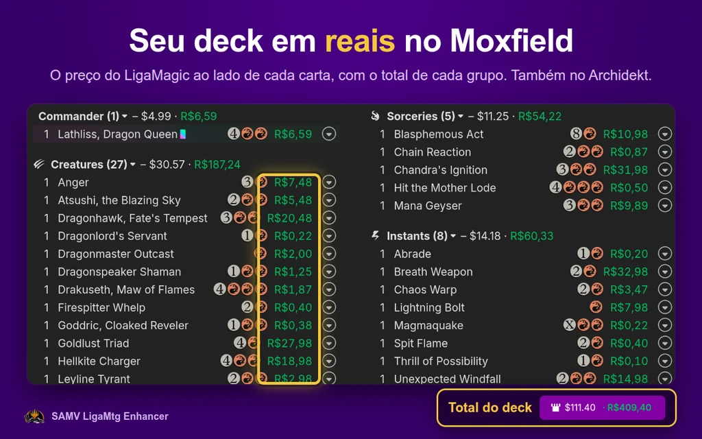
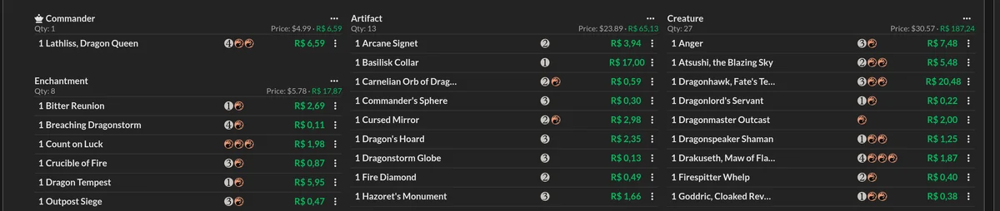
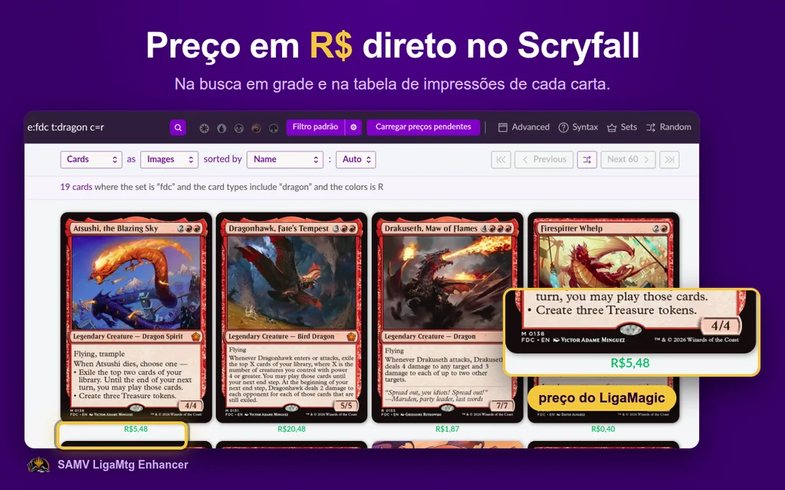
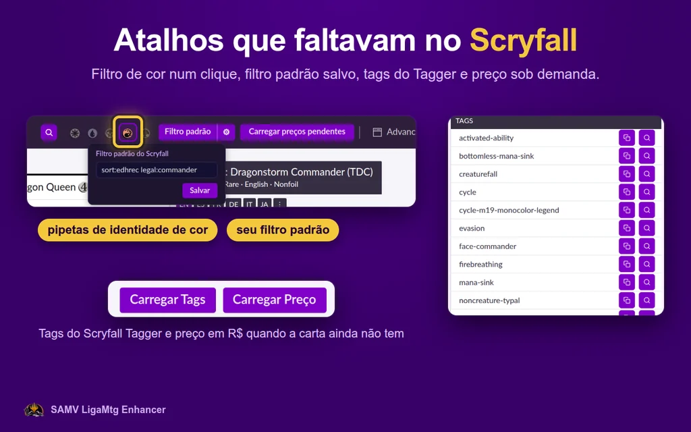
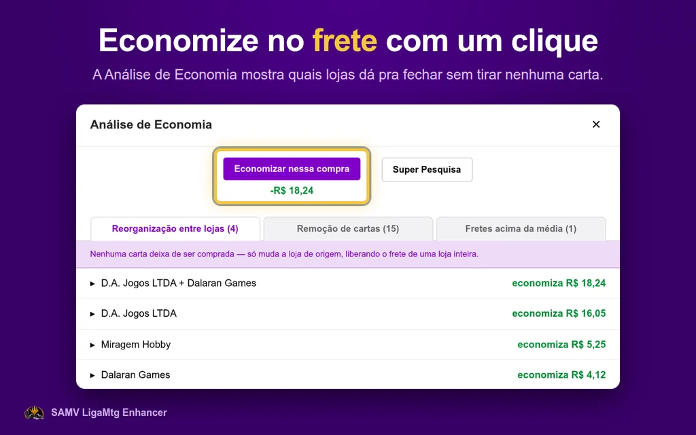
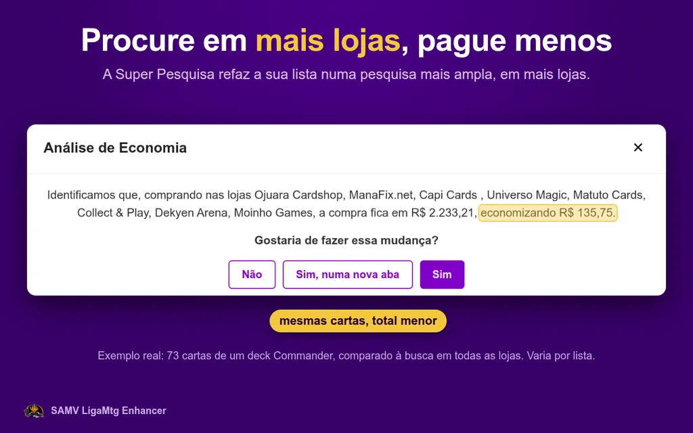
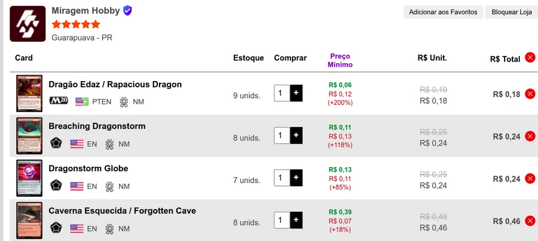
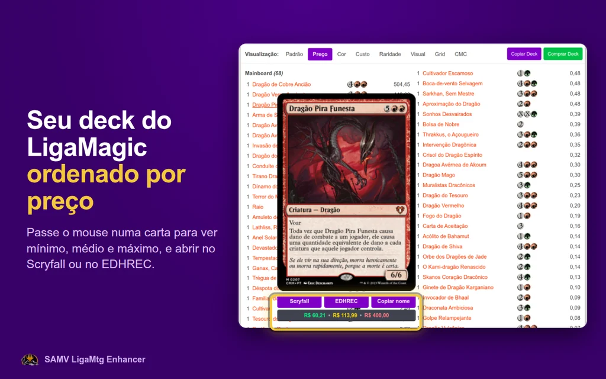
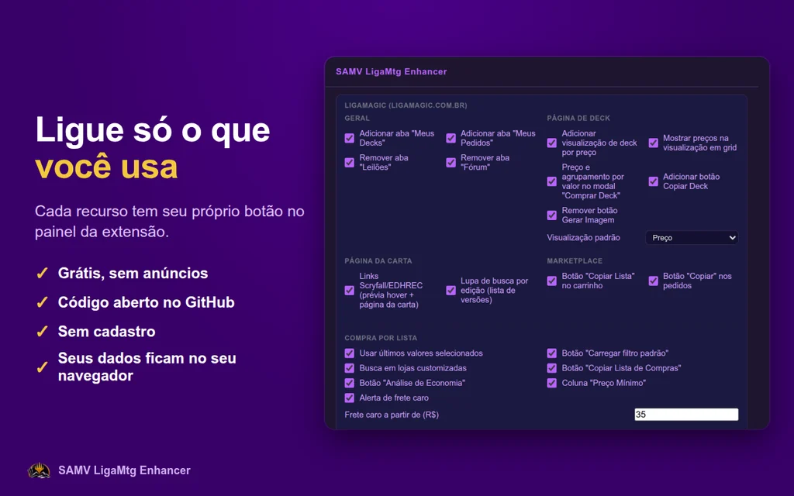

<h1 align="center">SAMV LigaMtg Enhancer</h1>

<b>Preço em reais do LigaMagic no Moxfield, no Archidekt e no Scryfall, e ferramentas para economizar na Compra por Lista do LigaMagic.</b>

  
  
  
  

<a href="https://chromewebstore.google.com/detail/samv-ligamtg-enhancer/maibnamkhohnboboioamggemkehhiekl"><b>Instalar na Chrome Web Store</b></a>

*Projeto independente e sem fins lucrativos da Sociedade Amigos do Vale (SAMV), para a comunidade de Magic: The Gathering. Compatível com LigaMagic, Moxfield, Archidekt, Scryfall e EDHREC, sem vínculo com nenhum deles.*

---

## Seu deck em reais no Moxfield e no Archidekt

- **Preço do LigaMagic em cada carta**, no lugar do dólar: na lista do deck, na visão em grade do Archidekt e no Visual Spoiler do Moxfield.
- **Total do deck e de cada grupo** (Criaturas, Feitiços, Terrenos…) em reais.
- **"Carregar preços pendentes"**: busca de uma vez os preços que faltam ou passaram de 7 dias. É preciso estar logado no LigaMagic.
- **A cor mostra a idade do preço**: verde até 7 dias, amarelo de 7 a 30, vermelho acima de 30.
- **"Comprar no LigaMagic"** no preview e no modal de carta do Moxfield; clicar no preço abre a carta no LigaMagic (opcional).

## Preço em R$ no Scryfall

- Selo de preço em R$ na busca em grade e coluna **R$** na tabela de impressões.
- **"Comprar no LigaMagic"** como primeira opção do painel "Buy This Card".

### Atalhos extras no Scryfall

- **Pipetas de identidade de cor** (W/U/B/R/G) ao lado da busca: um clique põe ou tira `ci:<cor>`, e a pipeta acende quando o termo já está no campo.
- **Lupa-link**: o ícone de busca abre a pesquisa numa aba nova com ctrl+clique ou clique do meio.
- **Filtro padrão**: um botão acrescenta seu filtro (ex.: `sort:edhrec legal:commander`) à busca; a engrenagem ao lado edita o filtro sem sair do Scryfall.
- **"Carregar Tags"**: traz as tags do Scryfall Tagger numa tabela na página da carta.
- **"Carregar Preço"**: busca o preço em R$ de uma carta que ainda não mostra a coluna R$.

## Economize na Compra por Lista do LigaMagic

- **Análise de Economia**: mostra quais lojas dá pra fechar comprando as mesmas cartas em outras lojas da compra, quais cartas caras valem a pena tirar e quais fretes estão acima do seu limite. **"Economizar nessa compra"** aplica a melhor combinação, e a análise se refaz quando a lista muda.
- **Super Pesquisa**: refaz a lista numa pesquisa mais ampla, em mais lojas, atrás de um total menor, e pergunta antes de trocar.

- **Coluna "Preço Mínimo"**: quanto cada oferta está acima do menor preço que você já viu daquela carta.

- **Alerta de frete caro**, **filtros que já vêm prontos** (idioma, extras, qualidade, sem estoque, pré-venda), **lojas extras na busca** (cole nome, URL ou ID da loja) e **"Copiar Lista de Compras"** separada por loja.

## No resto do LigaMagic

- **Página do deck**: aba "Preço" com as cartas ordenadas por valor, Mín/Méd/Máx na visão "Grid", preço no modal "Comprar Deck" e botão "Copiar Deck".
- **Prévia da carta**: botões Scryfall, EDHREC e Copiar nome, com Mín/Méd/Máx.
- **Página da carta**: lupa que filtra as lojas por edição.
- **Copiar** o carrinho e cada pedido de "Meus Pedidos" em um clique.
- **Menu**: abas "Meus Decks" e "Meus Pedidos"; esconda "Leilões" e "Fórum".

## Em qualquer site

- Selecione o nome de uma carta, clique com o botão direito e use **"Pesquisar carta"** para abrir no LigaMagic, no Scryfall ou no EDHREC.
- No **EDHREC**, a página do comandante ganha um botão **"Ver no LigaMagic"**.

## Tudo no seu controle

O ícone da extensão abre um painel com um botão para cada recurso, a aba padrão do deck, os filtros da Compra por Lista e o filtro do Scryfall. (Clicando no número da versão aparece uma opção de logs de diagnóstico.)

## Como usar

1. [Instale pela Chrome Web Store](https://chromewebstore.google.com/detail/samv-ligamtg-enhancer/maibnamkhohnboboioamggemkehhiekl).
2. Abra um deck no Moxfield ou no Archidekt e clique em **"Carregar preços pendentes"** (logado no LigaMagic).
3. Ajuste o que quiser no painel da extensão.

## Perguntas frequentes

**O que é o SAMV LigaMtg Enhancer?** Uma extensão gratuita e de código aberto para Google Chrome que mostra preços de cartas de Magic: The Gathering (MTG) em reais, com valores do LigaMagic, no Moxfield, no Archidekt e no Scryfall, e adiciona ferramentas de compra ao LigaMagic. Feita pela Sociedade Amigos do Vale (SAMV).

**Como ver o preço em reais de um deck do Moxfield?** Com a extensão instalada, abra o deck no Moxfield: cada carta mostra o preço em R$ do LigaMagic e o total aparece em reais. Para cartas sem preço salvo, clique em "Carregar preços pendentes" logado no LigaMagic.

**Funciona no Archidekt e no Scryfall?** Sim. No Archidekt, o preço em R$ aparece em cada carta e nos totais do deck; no Scryfall, na busca em grade e na tabela de impressões; no EDHREC, há um link para a carta no LigaMagic.

**De onde vêm os preços?** Do LigaMagic. A extensão guarda no seu navegador os preços que você vê no site ou busca com "Carregar preços pendentes". Não existe base de preços compartilhada entre usuários.

**Como economizar frete na Compra por Lista do LigaMagic?** Depois de pesquisar, o botão "Análise de Economia" mostra quais lojas podem ser fechadas comprando as mesmas cartas em outras lojas da compra, e quanto isso economiza; "Economizar nessa compra" aplica a melhor combinação.

**É grátis? É oficial?** É gratuita, sem anúncios e sem cadastro. Não é oficial: é um projeto independente, sem vínculo com LigaMagic, Moxfield, Archidekt, Scryfall, EDHREC ou Wizards of the Coast.

---

## Aviso legal

O **SAMV LigaMtg Enhancer** é uma ferramenta independente, feita sem fins lucrativos pela **Sociedade Amigos do Vale (SAMV)**, para a comunidade de jogadores. Não possui nenhum vínculo, parceria ou patrocínio de nenhuma das plataformas mencionadas: [LigaMagic](https://www.ligamagic.com.br), [Archidekt](https://archidekt.com), [Moxfield](https://moxfield.com), [Scryfall](https://scryfall.com) e [EDHREC](https://edhrec.com).

**Como a extensão funciona por baixo dos panos.** Os preços em reais que aparecem no Archidekt, Moxfield e Scryfall são exatamente os valores que você já viu no LigaMagic, guardados no seu próprio navegador na primeira vez que você visita a carta por lá — não existe uma base de preços compartilhada entre usuários. A extensão só sobrepõe essa informação na tela, de forma puramente visual: nada é enviado de volta para o LigaMagic nem para qualquer outro lugar. Dentro do próprio LigaMagic, os ajustes de menu, visualização de deck e filtros de compra também rodam localmente, com a sua sessão já autenticada: nenhum comportamento por trás dessas telas é escondido de você.

O uso desta extensão é de responsabilidade de quem instala.

Esta extensão **não contorna nenhuma medida de segurança, autenticação ou captcha** do LigaMagic ou de lojas parceiras: todas as requisições usam a sua própria sessão já autenticada, exatamente como o navegador já faria ao navegar normalmente pelo site.

Esta extensão **não contém links de afiliados** e **não gera nenhuma receita**. Os preços são exibidos exclusivamente como referência informativa. Consulte sempre o LigaMagic para valores atualizados.

Magic: The Gathering é marca registrada da Wizards of the Coast LLC. "LigaMagic" é marca de titularidade da LigaMagic Portal de Compras LTDA. Esta extensão não é produzida, endossada ou afiliada a nenhuma das duas. O nome é citado apenas para identificar com qual site a extensão é compatível.

## Privacidade

Nenhum dado pessoal é coletado, transmitido a terceiros ou armazenado fora do seu navegador. Tudo — preços, configurações e histórico do dia — roda e fica salvo localmente no seu próprio navegador.

## Desenvolvimento e contribuição

O código é aberto e pode ser auditado por qualquer pessoa. Para testar sem a loja: em `chrome://extensions`, ative o **Modo do desenvolvedor**, clique em **Carregar sem compactação** e escolha esta pasta. Não há etapa de build.

Sugestões e relatos de erro: [abra uma issue](https://github.com/Tales-K/samv-ligamtg-enhancer/issues/new). Licença [MIT](LICENSE).
